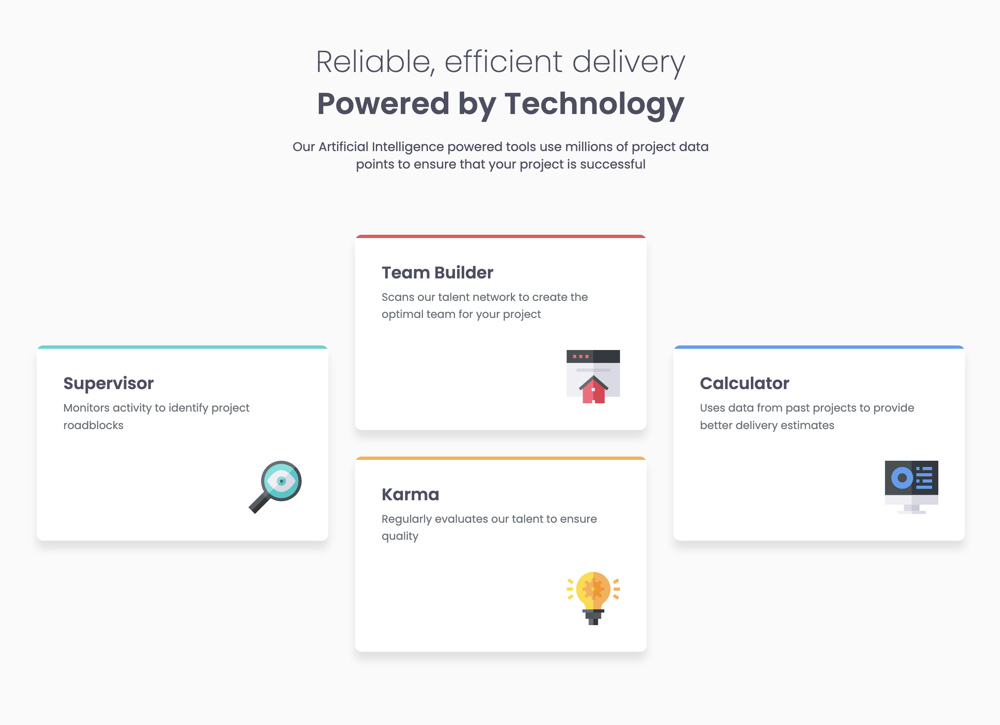

# Four-card-feature-section

A responsive four-card feature section built as part of a Frontend Mentor challenge.

- Live: [GitHub Pages]()
- Code: [GitHub]()

## Built with

- Semantic HTML 5
- SCSS
- CSS Grid
- Flexbox
- Media queries

## Author

- [GitHub](https://github.com/kirilenko-a)
- [Frontend Mentor](https://www.frontendmentor.io/profile/kirilenko-a)
